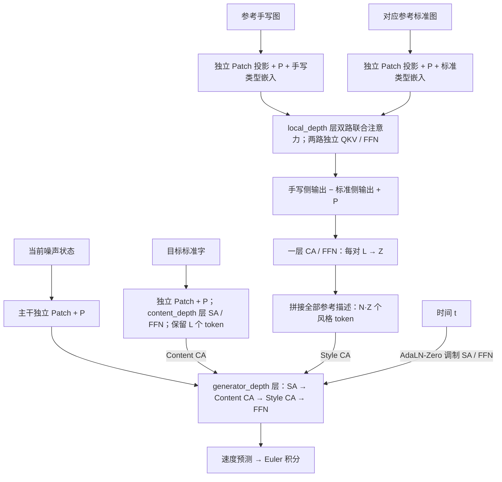

# Glyph2Hand：DiT + flow matching 手写字生成

根据同一书写者的若干参考手写字、每个参考字对应的标准字形，以及目标标准字，从纯高斯噪声生成目标手写图。参考手写与参考标准分别投影后直接做多层双路联合注意力，输出相减并补回位置编码，再逐对浓缩为风格描述；目标标准字保留独立内容编码器。本说明对照当前 `src/` 实现，记录模型、数据、flow MSE 训练、推理与恢复行为；默认参数是实验设置，不代表已验证的生成质量。

当前架构以本 README 和源码为准，服务器操作步骤见 [TRAINING.md](TRAINING.md)，源码索引见 [src/README.md](src/README.md)。[README.tex](readme/README.tex)、[README.pdf](readme/README.pdf) 及 `readme/README.v1-with-diagrams.*` 保留为历史设计，尚未同步本次双路联合注意力改动。通用线条图变形路线见 [../twist/](../twist/README.md)。

先检查模型拟合能力可用 [单作者训练入口](train-single/code.md)：运行时选择字符最多的训练作者，由 `train-single/config.py` 的 `SUBSET_SIZE` 限制固定字符子集，训练与生成评估使用同一子集，复用本训练器和续训逻辑。需要测试多作者缩小数据规模时使用 [train-half 入口](train-half/code.md)：`DATASET_SIZE` 按完整训练图像数计算比例，同时缩减作者数量和每位作者的字符池；命令可从 `Characters/` 直接运行。

## 运行位置与入口

从仓库根目录进入 `DiT-flow/` 后运行以下命令；Python 包名是 `src`，`DiT-flow` 不是导入包名。依赖和字体位于仓库根目录。

```bash
cd DiT-flow
python -m pip install -r ../requirements.txt
python -m src.prepare_data --help
python -m src.train --help
python count_parameters.py
python -m unittest discover -s tests -p "test_[!p]*.py" -v
```

依赖为 PyTorch、NumPy、Pillow 和 fontTools，版本范围见 `../requirements.txt`；其中 SciPy 供 twist 使用。本训练器仅支持 CPU 或单张 CUDA GPU，没有分布式训练入口。服务器使用 CUDA 版 PyTorch；默认 BF16 要求 GPU 支持 BF16。CPU 自动使用 FP32。

## 历史交互演示

`play.py` / `play.html` 按本次约定保持原样。该演示没有提供参考字对应的标准字形，调用接口与当前版本不兼容，暂不用于运行新架构；原 DiT-half 权重也不能加载到新模型。上面的测试命令只运行训练与模型测试，排除旧演示的 `test_play.py`。

## 模型接口与张量约定

设批量为 `B`、参考槽数为 `N`、图像边长为 `n`、块边长为 `p`、特征维为 `d`、每字描述数为 `Z=description_tokens`。空间 token 数 `L=(n/p)²`，风格序列长度为 `N·Z`。PyTorch 使用通道在前的布局：

| 输入 / 输出 | 形状与含义 |
|---|---|
| `reference_handwriting` | `[B,N,C,n,n]`，同一 episode 来自同一作者的参考手写图 |
| `reference_standard` | `[B,N,C,n,n]`，每张参考手写图对应的标准字形，形状和顺序必须完全一致 |
| `target_standard` | `[B,C,n,n]`，目标标准字，仅作为内容条件 |
| `reference_mask` | 可选 `[B,N]`；`True` 表示有效参考，省略时全部有效，每个样本至少有一个有效参考 |
| `state` / 预测速度 | `[B,C,n,n]`，当前流状态 / 像素速度 |
| `times` | `[B]`，连续流时间，训练采样范围为 `[0,1)` |
| `content` | `[B,L,d]`，目标标准字的空间 token |
| `style` | `[B,N·Z,d]`，各参考字的 Z 个描述直接拼接 |

默认 `C=1`。模型层可按 `in_channels` 构造多通道版本，但现有数据准备、训练器和预览只支持单通道灰度字图。训练字图取值为 `[-1,1]`，白色为 `+1`，黑色为 `-1`；噪声、流中间状态和预测速度不受此范围约束。

`Glyph2Hand.forward(state, times, target_standard, reference_handwriting, reference_standard, reference_mask=None)` 编码内容和参考后预测速度。也可以分别调用 `encode_content(target_standard)`、`encode_style(reference_handwriting, reference_standard, reference_mask=None)` 和 `predict_velocity(state, times, content, style, reference_mask=None)`。内容/风格编码均不依赖时间或当前状态，采样时各编码一次并在积分步间复用；训练中梯度保持连通，参数更新后需重算缓存。

目标标准字 **只通过内容 token 条件进入主干**，不参与构造起点，也不作为额外图像通道拼入流状态。流起点完全是 `N(0,I)` 噪声。

## 参考编码器



1. 参考手写与其标准字形分别将 `[B,N,C,n,n]` 合并为 `[B*N,C,n,n]`。两侧使用独立的 `Conv2d(kernel_size=p, stride=p, bias=True)` 将每个 Cp² 维 patch 投影成 d 维 token，再各自加同一套固定二维正弦余弦位置编码和各自的可学习类型嵌入。参考之间共享编码器参数，手写侧与标准侧不共享 patch 投影。
2. **投影后直接进入 local_depth 层双路联合注意力**，不先叠加独立 SA 编码。每层两侧分别做前置 LN、各自的 Q/K/V 投影，再将 Q、K、V 各按 token 维拼为长度 2L 的序列，以一次 softmax 联合注意力让两侧查询都能读取两张图的 K/V。结果按两侧拆开，分别做独立输出投影、LayerScale 残差和 LN/FFN/LayerScale 残差更新。两侧的 LN、QKV、输出投影、FFN、LayerScale 参数均独立；每一对参考独立交互，不跨参考字注意。
3. 对齐 patch 逐元素相减：`difference = handwriting_tokens - standard_tokens`。**相减后再加一次固定二维位置编码 P**，得到有空间位置的差分序列。两侧输入处仍各自加过一次 P；末尾补回 P 不能省略。
4. 共享的可学习查询 `Q_Z:[Z,d]` 通过 **恰好一个 CA → FFN 块** 读取每对的 L 个差分 token，得到 `[B*N,Z,d]`。Q 和 memory 分别归一化，CA 与 FFN 使用静态 LayerScale。查询和浓缩输出均不添加位置编码；压缩后没有描述 SA，也没有原始空间 token 旁路。
5. 将描述直接整理为 `[B,N·Z,d]`，供每个主干 Style CA 读取。不再进行参考集合浓缩，没有额外汇总查询、集合 CA/SA 层或末尾 LN。

类型嵌入形状为 `[2,1,d]`，与 Q_Z 一样以标准差 0.02 的正态分布初始化。每侧 QKV 权重使用 Xavier uniform、偏置为零；各残差的逐通道 LayerScale 初值为 1e-4。Z 表示每对参考的描述容量。差分是联合注意力后的两路隐状态之差，并不保证严格消除内容信息。

拼接不加参考组序号或绝对序列位置。同步重排参考手写、参考标准和掩码，会对应重排描述组；主干速度结果不变，允许浮点误差。掩码扩展到每对全部 Z 个描述，在每层 Style CA 中使用取反后的 `key_padding_mask`。补齐槽仍逐对编码，计算成本按槽数计算；应填有限字图数值，数据集将两侧均填白色 +1。每个样本至少要有一对有效参考。

## 内容编码器

`content_encoder.py` 独立读取**目标标准字**，使用 `PatchEmbed2D → content_depth 层 SA/FFN`；patch 投影后加一次固定二维位置编码，保留全部 L 个空间 token，没有类型嵌入、末尾查询或 CA 浓缩。它与参考标准字分支参数独立；local_depth 控制参考双路联合层数，content_depth 单独控制目标内容深度。内容 SA 和 FFN 使用静态 LayerScale。

双路联合注意力使用 `F.scaled_dot_product_attention(dropout_p=0.0)`，没有因果限制，两张图的全部 patch 互相可见。其余注意力使用 `nn.MultiheadAttention(batch_first=True, dropout=0.0)`，Q/K/V 投影独立、有偏置，不绑定 K/V，调用时 `need_weights=False`。FFN 为 `Linear(d,int(d*mlp_ratio)) → GELU → Linear(...,d)`。普通 LN 使用 PyTorch 默认可学习仿射和 `eps=1e-5`。

## 速度预测主干

当前状态经独立的 `C` 通道 patch 投影和固定二维位置编码，保持 `L` 个空间 token。连续时间编码使用

```text
f_k = exp(-log(10000) * k / (time_frequency_size/2))
e_raw(t) = concat(cos(t*time_scale*f_k), sin(t*time_scale*f_k))
e(t) = Linear → SiLU → Linear(e_raw(t))
```

二维位置编码按行、列各分配 `d/2` 维，分别使用 `sin → cos` 拼接、周期基数 `10000`。位置和时间频率是固定、非持久化 buffer，不是学习参数，也不写入 `state_dict`。`time_frequency_size` 默认是定义配置类时的 `384`；单独改 `hidden_size` 不会自动改它。

每个主干块依次为 **`SA → Content CA → Style CA → FFN`**：

- SA、FFN 使用各自的无仿射 LN（`eps=1e-6`），时间调制为 `(1+scale)*LN(x)+shift`。每块通过 `SiLU → Linear(d,6d)` 产生 `scale_sa,shift_sa,gate_sa,scale_ffn,shift_ffn,gate_ffn`，在 token 维广播；残差乘逐通道 gate，不使用 sigmoid。
- Content CA 读取 `L` 个内容 token，Style CA 读取 `N·Z` 个风格描述；两者使用独立的普通 Q/memory LN、MHA 和静态 LayerScale 残差缩放，没有时间调制。每层读取同一份内容/风格序列，查询来自该层更新中的主干特征。
- 输出头另用 `SiLU → Linear(d,2d)` 产生 `scale,shift`，调制无仿射 LN 后，共享 `Linear(d,p²C)` 输出每块速度，再按二维位置拼回整图。没有整图压成一个 token 的步骤。

各块的 `6d` 调制、输出头的 `2d` 调制及最终速度投影的权重和偏置均零初始化。主干 SA/FFN 的时间门初始为零；主干两个 CA、风格编码器的双路联合注意力/浓缩 CA/FFN、内容编码器的 SA/FFN 使用可学习的逐通道 LayerScale，初值为 `1e-4`，且不依赖时间。这样主干块和编码器均从接近恒等的残差更新开始；最终速度投影为零，因此模型初始速度输出为零。LayerScale 参数会随训练学习，只有主干 SA/FFN 仍使用 AdaLN-Zero 的时间相关门控。

## flow 损失与采样

`build_flow_matching_batch` 对每个样本采样独立高斯噪声和均匀时间，也允许显式传入 `noise`、`times`：

```text
x0 = noise，noise ~ N(0,I)
xt = (1-t)*x0 + t*target_handwriting
u  = target_handwriting - x0
L_flow = mean((predicted_velocity-u)²)
```

同一纯噪声 `x0` 用于路径和监督速度。`build_flow_matching_batch(target_handwriting, noise=None, times=None)` 不接收标准字。均方误差平均全部样本、通道和像素，训练器以 FP32 计算此项。目标手写真值不加入参考集合；路径不是已知的自然字形变形轨迹。

训练目标只有 **`L_train = L_flow`**。每个 batch 直接更新一次优化器；验证与预览也使用同一个 flow MSE。每个 batch 只编码一次内容和风格，供速度预测复用；验证结束后恢复模型原来的 train/eval 状态。

`sample_euler(model, target_standard, reference_handwriting, reference_standard, steps=..., noise=None, reference_mask=None)` 在 `no_grad` 下各编码一次内容和风格，从纯高斯噪声用 `J=steps` 个等长步积分：`t_j=j/J`、`x←x+v(x,t_j,content,style)/J`（最后一次网络时间为 `(J-1)/J`）。可显式传入 `noise` 复现相同起点。训练状态和积分中途不裁剪，只在返回时裁剪 `[-1,1]`；返回归一化张量，灰度映射由预览/调用方完成。

## 当前默认配置

新训练读取 `src/config.py` 的两个 dataclass，不读取额外配置文件，也不提供模型/学习率的训练命令行覆盖。

| `ModelConfig` 字段 | 默认值 | 含义 |
|---|---:|---|
| `image_size` / `patch_size` / `in_channels` | `64` / `8` / `1` | 灰度图与块；网格 `8×8`，`L=64` |
| `hidden_size` / `num_heads` / `mlp_ratio` | `384` / `12` / `2.0` | 每头维度 `32`，FFN 内宽 `768` |
| `local_depth` / `content_depth` / `generator_depth` | `10` / `10` / `12` | 每对参考的双路联合注意力 / 目标内容 SA / 主干深度 |
| `description_tokens` | `24` | 每对参考的描述数 Z；默认 4 对参考产生 96 个风格 token |
| `time_frequency_size` / `time_scale` | `384` / `1000.0` | 时间 Fourier 特征维度 / 放大倍数 |

模型要求图像边长可被块边长整除，`hidden_size` 可被头数和 `4` 整除，时间特征维为正偶数；参考联合注意力、内容和主干深度允许 `0`（参考仍保留差分、补位置和单层浓缩）。默认可学习参数总数 **76,521,664**：参考编码器 **24,938,112**，内容编码器 **11,871,360**，主干 **39,712,192**；其中包含 LayerScale 参数。`count_parameters.py` 支持所有模型字段的 kebab-case 参数（如 `--hidden-size 128 --time-frequency-size 128 --content-depth 4`），仅用于统计，不改变训练配置。

| `TrainingConfig` 字段 | 默认值 | 含义 |
|---|---:|---|
| `steps` / `batch_size` | `1000000` / `64` | 优化器步数 / batch 大小，每 batch 更新一次 |
| `min_references` / `max_references` | `4` / `4` | 当前固定 4 个参考；调整范围后均匀整数采样，包含端点 |
| `learning_rate` / `min_lr_ratio` / `warmup_steps` | `1e-4` / `0.1` / `1000` | 基础 LR / 最低比例 / 线性预热步数 |
| `weight_decay` / `gradient_clip` | `0.01` / `1.0` | AdamW 衰减 / 梯度 L2 阈值 |
| `precision` / `preload_to_gpu` / `workers` | `bf16` / `False` / `4` | CUDA 精度 / 字图常驻显存 / 训练加载 worker 数 |
| `val_batches` / `validate_every` | `16` / `1000` | 验证 batch 数 / 验证间隔 |
| `save_every` / `log_every` | `500` / `50` | `last.pt` 保存间隔 / 日志间隔 |
| `sample_steps` / `seed` | `32` / `42` | 预览 Euler 步数 / 种子 |

批量就是 `batch_size`（默认 `64`）。计数项须为正整数，`0<=warmup_steps<steps`、`workers>=0`、`min_references<=max_references`；LR 和裁剪阈值有限且为正，权重衰减有限且非负，最低 LR 比例在 `[0,1]`，精度仅接受 `fp32/fp16/bf16`，预加载开关须为布尔值。

## 数据准备与 episode

```bash
python -m src.prepare_data --gnt-root ../data/gnt --font ../fonts/WenJinMinchoP0-Regular.ttf --output ../data/prepared
```

训练说明使用文津宋体；代码不硬编码字体，实际字体由必填 `--font` 决定。

准备入口的必填参数为 `--gnt-root`、`--font`、`--output`。可选参数：`--font-index 0`、`--image-size 64`（模型默认值）、`--margin 4`、`--min-characters 5`（默认 `max_references+1`）、`--val-fraction 0.1`、`--seed 42`（训练默认种子）。修改模型图像尺寸或参考上限后，应检查预处理数据是否仍满足训练要求。

- 递归读取所有 `.gnt`（后缀不区分大小写），按文件排序；每个文件视为一个作者，作者 ID 为文件 stem，要求至少两个文件且 stem 不重复。入口不自动识别官方 Test 数据，只应放入训练集 GNT。
- GNT 的数值字段按小端解析（10 字节头，记录长度须等于 `10+width*height`）；字符直接按原始两个标签字节解码 GBK。截断、无效尺寸或非法标签会报错，不静默跳过损坏记录。
- 只保留单个基本 CJK 字符 `U+4E00..U+9FFF` 且字体 cmap 支持的字；每位作者只留同字首次成功处理的样本。空白字图、缺字、非 CJK、重复字和字符数不足的作者有跳过计数。
- 手写和标准字各自裁掉纯白背景，保持宽高比、LANCZOS 缩放至可用边长 `image_size-2*margin`，居中贴到白色方形。默认 `64×64`、边距 `4`；没有旋转、弹性变形或其他随机图像增强。标准字先以 `4*image_size` 字号渲染，再用同一流程归一化。
- 按作者划分 train/val，使用独立 `random.Random(seed)` 打乱作者；验证作者数为 `min(W-1,max(1,round(W*val_fraction)))`。两侧作者不重叠，但字符类别可以重叠；不是按字类别划分。
- 生成 uint8 的 `writers/*.npy`、`standards.npy` 和最后写入的完成标志 `manifest.json`（数据格式版本 `1`）。manifest 记录字符索引、作者文件/标签/划分、字体及像素文件 SHA-256、尺寸、边距、种子与跳过统计。输出必须新建或为空，准备中断后的非空目录不会直接重做覆盖。

训练启动把全部 train/val 字图以 uint8 预加载一份，逐作者读取 NPY，检查 dtype/shape 和标签索引；CPU 使用 `RawArray` 共享给 fork/spawn worker，训练与验证共用同一份字图，采样不再访问 NPY。占用字节为 `(手写图数+标准图数)*image_size²`，不含模型、浮点批次和加载器开销。`preload_to_gpu=True` 时加载到选定 CUDA 设备，并强制 `workers=0`。

每个 episode 的独立 RNG 为 `random.Random(f"{seed}:{index}")`：均匀选作者、均匀选参考数，再无放回抽 `N+1` 个不同字符，首个为目标、其余为参考。作者须有至少 `max_references+1` 个不同字符；按作者均匀采样并非按全部字图均匀采样。按作者清单中的字符标签，从 `standards.npy` 同时取出目标标准字和每个参考字的标准字形；标准字库按全局字符标签索引，不按作者内样本序号索引。字图此时从 uint8 转 FP32：`pixel/127.5-1`，参考手写和标准均补到 `max_references` 个槽位并附同一布尔掩码。目标字符不会出现在同 episode 的参考中。

episode 由种子和全局索引确定，不受 worker 数或预取进度影响。续训从 `saved_step*batch_size` 继续索引；验证使用固定索引与 `seed+1`。数据指纹是 **manifest 原始字节的 SHA-256**，连空白变化也会触发续训拒绝；加载器没有重新核验 manifest 中的 NPY/字体内容哈希，因此它不是对所有文件重新做完整性校验。

## 优化、验证、日志与退出

训练使用 AdamW，`betas=(0.9,0.95)`，全部模型参数进入同一组，未单独排除 bias/LN/查询的权重衰减。优化器步数从 `1` 开始：预热 LR 为 `base_lr*step/warmup_steps`，随后余弦下降，在 `steps` 达到 `base_lr*min_lr_ratio`。`--stop-after` 仅提前停在绝对步数，不重设此日程。

CUDA 可选 BF16/FP16/FP32，启用 TF32 matmul/cuDNN；CPU 固定 FP32。只有 FP16 启用 GradScaler。先 AMP 反缩放再计算全局梯度 L2 范数，安全裁剪后更新优化器；float32 范数归约非有限时以 float64 重算。真实非有限梯度不更新参数：FP16 降低 scaler，用同一数据、时间与噪声重试，最多 `16` 次尝试；BF16/FP32 立即报错停止。非有限训练损失立即停止，不做溢出重试；异常保留已成功保存的检查点，不保证另存故障当前步。

每隔 `validate_every` 及计划结束步以当前模型验证和生成预览；正常 `--stop-after 100` 也会验证、保存。验证在隔离的 PyTorch RNG 中用 `seed+10000` 固定时间/噪声，预览在验证损失之后采样，避免改变训练 RNG 或损失采样序列。验证 batch 数为 `val_batches`、worker 固定 `0`；flow MSE 按样本数平均。更改精度/设备可能影响数值，代码不保证跨设备逐位一致。

| 输出 | 行为 |
|---|---|
| `run.json` | 模型/训练设置、manifest 指纹、设备、实际精度、torch 版本和当前预加载方式；续训会重写 |
| `metrics.jsonl` | 间隔、验证和结束步追加；`train_loss`、`lr`、裁剪前 `grad_norm`、`grad_clip_scale`、可选 `val_loss`，以及带 `s` 的本次启动耗时字符串 |
| `peak_allocated`（CUDA 日志字段） | `torch.cuda.max_memory_allocated/1024³`，字符串标记 `GB`，实际为 GiB；不是 reserved memory 或本步单独峰值 |
| `gradient_diagnostics.jsonl` | 启动/续训首步、日志间隔和计划末步记录梯度；非有限损失/梯度和 float64 回退额外记录 |
| `previews/step_XXXXXXX.png` | 验证第一批最多四个样本，列出全部参考槽、目标标准字、真值和当前模型生成图；补齐参考显示空白 |
| `best.pt` | 当前模型 flow MSE 验证目标严格降低时保存的完整训练状态 |
| `last.pt` | 保存间隔及正常结束/响应退出请求时的完整训练状态，可能落后于内存中的当前步 |

日志普通浮点固定八位小数，绝对值 `>=1e8` 或非零且 `<1e-7` 时用科学计数法；数字仍为 JSON number，耗时/显存为带单位字符串。诊断列出梯度最大的八个参数和直接所属模块（不是整个参考/主干递归汇总）、最大梯度元素、裁剪比例、AMP scale、尝试序号和异常参数名，Inf/NaN 以字符串保存；非有限损失事件只有相应损失/尝试信息。

训练循环响应 SIGINT/SIGTERM：完成当前优化器步后，记录并保存 `last.pt`；退出请求会跳过该步验证。进程强杀或一般运行异常不会触发这个保存流程。详细梯度和存储排查见 [TRAINING.md](TRAINING.md)。

## 检查点与续训规则

```bash
python -m src.train --data ../data/prepared --output ../runs/DiT-flow/first --device cuda --stop-after 100
python -m src.train --data ../data/prepared --output ../runs/DiT-flow/first --resume ../runs/DiT-flow/first/last.pt --device cuda
```

必填 `--data`、`--output`；可选 `--resume`、`--device`（默认 `auto`：有 CUDA 则 CUDA，否则 CPU；也支持 `cuda:N`）、`--workers`、`--stop-after`。训练文件也支持从仓库根目录执行 `python DiT-flow/src/train.py ...`，参数路径仍相对当前工作目录；推荐统一从 `DiT-flow/` 运行模块入口。

当前检查点版本 **6**，保存 `settings`、manifest 指纹、已完成步数、最优验证损失、当前模型、AdamW、GradScaler、CPU 和选定 CUDA 设备的 PyTorch RNG 状态。`best.pt` 也可续训，只有一套模型权重。版本 1/2/3/4/5 的旧架构或训练设置检查点在写输出前被明确拒绝，不能直接续训；原预处理数据满足尺寸和字符数要求时仍可复用。版本 6 包含配对参考的双路联合注意力参数、类型嵌入，以及当前 LayerScale 与 flow MSE 训练设置。

续训恢复保存的模型与训练配置；修改当前 `config.py` 的架构、LR、种子等不会替换旧运行设置。例外是运行方式 `preload_to_gpu` 始终读取当前配置，不写入检查点 `settings`，而单独记在 `run.json`；`--device`、`--workers`、`--stop-after` 也可在续训时指定。必须满足保存步数 `< stop-after/总步数`，不能靠 `--stop-after` 延长已保存的总日程。

新训练拒绝非空输出，只有配置/指纹一致、仅含 `run.json` 和空 `previews/` 的未开始运行可重试。续训允许新输出目录；非空旧目录须有一致的 `run.json`，且其中 `last.pt` 不能比所选恢复点新。从较早的 `best.pt` 回退时应选择新输出目录。

保存先写完整 `.pt.tmp`，flush/fsync 后替换对应 `.pt`；识别为 I/O 的错误最多尝试三次，间隔 `1`、`2` 秒，不重复训练，失败临时文件尝试清理。普通序列化错误直接抛出。先保存刷新后的 `best.pt`，再按条件保存 `last.pt`；两者不是一笔整体事务，后者失败时前者可能已经更新。需要额外一份完整检查点的空间，持续失败会报错停止。

## 计算规模与已有验证

参考注意力主项为 `O(local_depth*N*(2L)²*d + N*Z*L*d)`；内容为 `O(content_depth*L²*d)`；主干 `J` 步注意力为 `O(J*generator_depth*(2L²+L*N*Z)*d)`，其中两个 `L²` 分别来自 SA 和 Content CA。还需计入投影/FFN、反向和 batch 成本。缓存内容/风格编码减少重复提取，当前采样仍每步重算主干各层的内容/风格 LN/K/V 投影；没有 K/V cache。代码使用 PyTorch SDPA 和 MHA，具体后端取决于设备、版本、dtype 等，不保证始终使用 FlashAttention。

现有测试覆盖双路联合注意力与手算 softmax 一致、双向交互、两侧 patch/QKV 梯度、差分后位置编码和无查询位置编码、参考标准字逐一配对、参考重排/掩码、flow/采样、GNT 和真实字体预处理、共享内存及无文件采样、参考范围/目标排除、设备选择、日志格式、梯度溢出、保存失败以及小模型 CPU 中断续训与连续训练一致性。CUDA 设备选择测试使用模拟；这些测试不等于真实 3090 性能或生成质量验证。
