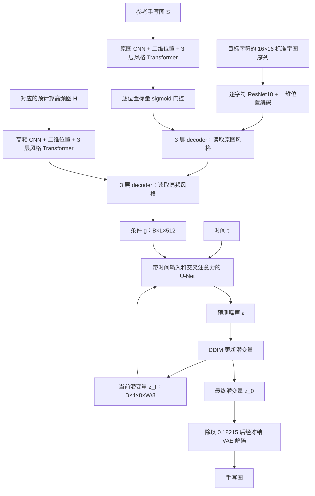

# One-DM 技术解构：以公开代码为准

阅读日期：2026-10-06。代码目录：`E:/Codes/torch/Characters/One-DM`。提交：`dde2205a70a2c70d1786503d198a795358c80ee4`。

本文核对了数据加载、风格与内容编码、Transformer、U-Net、扩散采样、两阶段训练、OCR、配置与入口代码。论文依据为 [arXiv v2](https://arxiv.org/html/2409.04004v2)。论文结论、当前代码事实和对 Glyph2Hand 的建议分别说明。

执行范围：静态逐文件阅读，以及不下载权重的 CPU 局部检查；没有进行完整训练或生成效果复现。局部检查使用本机 PyTorch 2.9.0 与 torchvision 0.24.0，原仓库环境是 PyTorch 1.13.1，因此不能将局部检查等同于原环境的完整复现。One-DM 原代码未修改。

## 1. 最重要的结论

One-DM 实际公开的模型可以写成：

$$
g=F_\phi(\text{参考手写图},\text{参考高频图},\text{目标字形序列}),
\qquad
\hat\epsilon=U_\theta(z_t,t,g).
$$

它先把参考笔迹和目标内容融合成“带风格的目标字符 token”，再用这些 token 条件化潜空间扩散。生成条件不是一个与目标内容无关的全局书写者向量。

公开代码与论文示意存在几项重要差异：

| 项目 | 论文描述 | 本地提交的实际实现 |
|---|---|---|
| 风格对比损失 | 主要描述高频分支 LaplacianNCE | 高频、原图两个分支都计算 SupConLoss |
| 融合方式 | 原图和高频特征相加，内容查询，再自注意力 | 三层 decoder 读取原图风格，再三层 decoder 读取高频风格 |
| 内容编码器 | ResNet18 加两层 Transformer encoder | ResNet18 加一维位置编码；没有独立的两层内容 Transformer encoder |
| 扩散预测目标 | 附录以恢复干净样本的形式推导 | 主训练明确预测噪声 ε，监督为潜空间噪声 MSE |
| CFG | 论文报告 classifier-free guidance | 当前训练、模型、采样调用链未实现条件丢弃和双分支 CFG 组合 |
| 训练长度 | 主文报告 700 epochs、再 4500 iterations | scratch 配置 1000 epochs，finetune 配置 10 epochs，未硬编码 4500 步终止 |

因此，不能仅凭论文框图重建这份仓库，也不能仅凭这份仓库断言论文全部实验的确切实现。

## 2. 完整计算路径

训练还多出同作者的第二张参考及其高频图，供两个分支构造对比损失；生成条件只读取第一张。训练真值手写图经 VAE 编码、加噪后作为 U-Net 输入。

调用关系：[训练入口](E:/Codes/torch/Characters/One-DM/train.py:59) → [Trainer](E:/Codes/torch/Characters/One-DM/trainer/trainer.py:32) → [UNetModel.forward](E:/Codes/torch/Characters/One-DM/models/unet.py:969) → [Mix_TR](E:/Codes/torch/Characters/One-DM/models/fusion.py:88)。

## 3. 数据：one-shot 指生成所需参考数量

训练目标是一张英文单词图。`IAMDataset` 根据其书写者 ID，从该作者目录随机抽两张不同的参考图片，称为 anchor 和 positive。二者不要求文字内容相同。

| 数据 | 典型形状 | 数值与用途 |
|---|---|---|
| 目标手写图 `img` | B×3×64×W | RGB，归一化至 [-1,1]，进入 VAE |
| 参考手写图 `style` | B×2×64×Ws | 灰度 [0,1]，白色补齐，宽度最多 352 |
| 参考高频图 `laplace` | B×2×64×Ws | 灰度 [0,1]，黑色补齐，和参考同名 |
| 目标内容 `content` | B×L×16×16 | 每个字符查一张 Unifont 位图，再反色 |
| 作者 ID `wid` | B | 仅作为监督对比学习标签 |
| OCR 标签 | B×L，另带长度 | 仅在微调时用于 CTC |

`forward()` 取 `style[:,0]` 和 `laplace[:,0]` 构造生成条件；第二张只进入对比学习。`generate()` 即使收到多张参考，也只读取第一张。因此它不是多参考融合模型。配置里的 `NUM_IMGS: 15` 没有控制实际参考数量。

还应注意：

- 公开 loader 将目标单词长度限制为最多 9 个字符。它不是任意长整行训练管线。
- 推理代码偏向抽取宽度大于 128 像素的参考；附近注释写的是 32，应以条件表达式为准。所有图都不足 128 时，会使用遍历中的最后一张。
- 目标字符表硬编码为 81 个符号，包含 OCR blank 所用的 `_`。`ContentData` 对不在表内的字符会查找失败；Unifont 覆盖 Unicode 不意味着这个公开入口已经支持任意 Unicode。
- 同作者两张参考的抽样没有显式排除当前目标图。因此从代码本身看，训练参考偶尔可以包含目标真值；不能假设它严格实现了参考与目标隔离。
- 原图、高频图和内容序列的补齐位置没有传入 attention padding mask。全白/全黑补齐仍会被编码和注意力读取，不能视为数学上被忽略。
- loader 定义了 Laplacian 卷积核，但实际加载的是预生成 PNG；本仓库没有展示这些 PNG 的完整预处理过程。尤其不能从未使用的核定义推断有符号响应如何被缩放或截断为 uint8。

依据：[采样与读取](E:/Codes/torch/Characters/One-DM/data_loader/loader.py:69)、[批处理](E:/Codes/torch/Characters/One-DM/data_loader/loader.py:140)、[推理参考选择](E:/Codes/torch/Characters/One-DM/data_loader/loader.py:203)、[推理字符映射](E:/Codes/torch/Characters/One-DM/data_loader/loader.py:253)。

## 4. 风格编码：保留二维局部证据，再做整图交互

两条风格分支结构相同、参数独立。所谓 `low` 分支实际读原图，没有做低通滤波；把它理解为“空间域/原图分支”更准确。

以参考尺寸 64×352 为例：

\[
B\times1\times64\times352
\rightarrow B\times256\times4\times22
\rightarrow B\times512\times4\times22
\rightarrow 88\times B\times512.
\]

第一步是改过的 torchvision ResNet18：保留到 layer3，去掉 layer4、平均池化与分类头。注意 torchvision ResNet 的 forward 仍执行 flatten，因此代码随后显式还原成 `B×256×4×22`，其中高度 4 是写死的。这隐含参考图高为 64 的约束。

第二步使用另一个自定义 ResNet 的 `conv5_x`，由两个残差块组成，通道 256→512，步长为 1，使用 dilation=2 的卷积扩大感受野，不再降低空间分辨率。

加入二维正余弦位置后，展平为 88 个位置 token，送入三层风格 Transformer encoder。每层是 pre-LN 的 SA→FFN，加残差；维度 512，8 个头，FFN 2048，dropout 0.1，整个 encoder 末尾还有 LayerNorm。

因此，生成路径保留的是一组带空间和上下文的参考证据，**没有先平均池化成一个全局风格向量**。均值池化只出现在对比学习投影头中。

原图分支再执行：

\[
w_j=\operatorname{sigmoid}(a^\top f_j+b),\qquad
\tilde f_j=w_j f_j.
\]

这是每个位置一个标量，广播到全部 512 通道。它不是逐通道门，也不是直接在原像素上预测分割 mask；它在三层 Transformer 之后过滤上下文化的 token。没有显式笔画像素标签，门控由生成损失和原图对比损失共同训练。

高频分支强调轮廓变化，但“高频”等于“纯风格”并不成立：字符结构和背景噪声也可以产生高频响应，风格与内容的分离主要还依赖训练目标。

依据：[分支构造与特征提取](E:/Codes/torch/Characters/One-DM/models/fusion.py:47)、[空洞卷积](E:/Codes/torch/Characters/One-DM/models/resnet_dilation.py:15)、[门控位置](E:/Codes/torch/Characters/One-DM/models/fusion.py:107)。

## 5. 内容与融合：每个目标字符对应一个条件 token

内容输入不是整张排版好的目标图，而是 `B×L×16×16` 的字符位图序列。代码将 B 和 L 合并，用同一个完整 ResNet18 的卷积部分逐字符处理：

\[
(BL)\times1\times16\times16
\rightarrow(BL)\times512\times1\times1
\rightarrow L\times B\times512.
\]

然后加入一维位置编码，用来区分目标字符串中第几个字符。这里没有额外的独立内容 Transformer encoder。

实际融合是：

\[
T_0=\operatorname{PE}_{1D}(E_{\rm content}(C)),
\quad T_1=D_{\rm spa}(T_0,\tilde F_{\rm spa}),
\quad g=D_{\rm fre}(T_1,F_{\rm fre}).
\]

两段 D 都是三层 Transformer decoder，共六层。每层默认执行：

\[
\begin{aligned}
T'&=T+\operatorname{SA}(\operatorname{LN}(T)),\\
T''&=T'+\operatorname{CA}(\operatorname{LN}(T'),F,F),\\
T_{\rm out}&=T''+\operatorname{FFN}(\operatorname{LN}(T'')).
\end{aligned}
\]

Q 来自目标字符 token，K/V 来自相应风格分支。没有 causal mask，所有目标字符同时交互，`decoder` 这个类名不意味着逐字符自回归生成。

最终条件尺寸为 `B×L×512`。它的语义是“带有参考写法的目标内容”，不是“参考字原样复制”，也不是“作者固定 ID 嵌入”。换目标字符串，g 会改变；换参考，g 也会改变。

一个对中文迁移很关键的推论：如果直接沿用公开实现来生成单个汉字，L=1，送到 U-Net 的只有一个条件 token。交叉注意力对一个 key 的 softmax 恒为 1，每个 head 的 CA 输出不再随空间 query 改变，等价于向各位置提供相同的投影条件向量；空间结构仍需由 U-Net 当前状态、卷积和自注意力恢复。这不意味着它不能生成单字，但不能把它解释成 U-Net 正在逐空间位置检索多个笔画条件。

这是对公开英文结构在 L=1 时的数学推论，不是对未公开中文实现的断言。

依据：[实际融合](E:/Codes/torch/Characters/One-DM/models/fusion.py:125)、[decoder 每层](E:/Codes/torch/Characters/One-DM/models/transformer.py:232)。

## 6. U-Net：两个空间尺度，四处条件注意力

入口实际参数为 `model_channels=512`、`channel_mult=(1,1)`、`num_res_blocks=1`、`attention_resolutions=(1,1)`、`num_heads=4`。

`attention_resolutions` 是下采样倍率集合的用法，两个 1 不表示两组 attention。倍率 1 的分辨率层有 attention，倍率 2 的普通上下行层没有；中间 bottleneck 独立配置一个 attention。

用目标输出 64×W、潜空间尺寸 8×(W/8) 表示：

| 顺序 | 空间尺寸 | 模块 |
|---|---|---|
| 输入 | 8×W/8 | 3×3 Conv，4→512 |
| 编码高分辨率 | 8×W/8 | ResBlock + SpatialTransformer |
| 下采样 | 4×W/16 | stride-2 Conv，512 通道 |
| 编码低分辨率 | 4×W/16 | ResBlock |
| 中间 | 4×W/16 | ResBlock + SpatialTransformer + ResBlock |
| 解码低分辨率 | 4×W/16 | 两个 ResBlock，各先拼接对应 skip，1024→512 |
| 上采样 | 8×W/8 | 最近邻放大 + 3×3 Conv |
| 解码高分辨率 | 8×W/8 | 两组 ResBlock + SpatialTransformer，各先拼接 skip |
| 输出 | 8×W/8 | GroupNorm + SiLU + 零初始化 Conv，512→4 |

总计 8 个 ResBlock、4 个 SpatialTransformer。每个 SpatialTransformer 默认一层 `SA→CA→GEGLU FFN`，使用 LN 和残差；外围用 GroupNorm、1×1 投影、零初始化输出投影及大残差。U-Net attention 是 4 头、每头 128 维；风格与融合 Transformer 是 8 头、每头 64 维，二者不要混淆。

时间走正余弦嵌入 512 维，再经 MLP 512→2048→2048。每个 ResBlock 把时间特征投影回 512 通道并广播相加。默认 `use_scale_shift_norm=False`，这里没有使用 DiT 的 AdaLN-Zero 时间调制。模型仍有多处零初始化：ResBlock 末尾卷积、SpatialTransformer 输出投影、U-Net 输出头。

条件 g 在四处交叉注意力中被读取：Q 来自当前潜图特征，K/V 来自 g。因此目标内容和笔迹条件会参与每一步去噪。

它借用了 Stable Diffusion 的 VAE 和 LDM 结构思路，但没有从 SD 载入预训练 U-Net 或 CLIP 文本编码器。这个任务的条件网络和生成 U-Net 是单独构建和训练的。

依据：[构造参数](E:/Codes/torch/Characters/One-DM/train.py:60)、[U-Net 构造](E:/Codes/torch/Characters/One-DM/models/unet.py:773)、[空间 Transformer](E:/Codes/torch/Characters/One-DM/models/unet.py:224)、[时间注入](E:/Codes/torch/Characters/One-DM/models/unet.py:519)。

## 7. 第一阶段：潜空间噪声回归 + 两个风格对比损失

为避免和当前 Glyph2Hand 的 flow 时间端点混淆，本节用 z 表示潜变量。

目标手写图 Y 经冻结 VAE：

\[
z_0=0.18215\,\operatorname{sample}(q_{\rm VAE}(z\mid Y)).
\]

不是直接取 VAE posterior 均值，而是采样。分辨率缩小 8 倍，RGB 三通道变为潜空间四通道。

训练采样整数 t∈{0,…,999}，使用线性 β schedule，从 10⁻⁴ 到 0.02：

\[
\alpha_t=1-\beta_t,\quad\bar\alpha_t=\prod_{i\leq t}\alpha_i,
\quad z_t=\sqrt{\bar\alpha_t}z_0+\sqrt{1-\bar\alpha_t}\epsilon.
\]

默认 ε 是标准高斯；`noise_offset` 可额外加入每张图、每个通道共享的空间常量高斯偏移，默认 0。

U-Net 输出 ε̂，重建名义下的损失实际上是：

\[
\mathcal L_\epsilon=\operatorname{MSE}(\hat\epsilon,\epsilon).
\]

每条风格分支对 anchor 和 positive 分别做逐 token MLP `512→4096→256`，再平均池化，最后 L2 归一化，得到 `B×2×256`。**顺序是先非线性投影，再平均；不是先把风格特征平均后过 MLP。**

监督对比损失使用作者 ID 构造正例集合，temperature=0.07。两张同作者参考保证每个样本至少有配对正例，同 batch 其他同作者样本也算正例：

\[
\mathcal L_{\rm supcon}
=-\frac1{|A|}\sum_{i\in A}\frac1{|P(i)|}
\sum_{p\in P(i)}\log
\frac{\exp(q_i^\top q_p/\tau)}{\sum_{a\ne i}\exp(q_i^\top q_a/\tau)}.
\]

实际总损失为：

\[
\boxed{\mathcal L=\mathcal L_\epsilon+
\mathcal L_{\rm high}+\mathcal L_{\rm spatial}}.
\]

三者系数都是 1。对比学习只作用于投影后的全局向量，不能保证每个空间 token 都已经排除了内容。

作者 ID 只出现在 loss，不作为 U-Net 条件，因此推理可以面对新作者。DDP 只同步梯度；这里没有 all-gather 汇集风格向量，负例池是单卡 minibatch 的两倍。配置每卡 batch=96 时，每个分支的对比矩阵是 192×192，不是全局 4 卡合并后的 768×768。

预训练方面，三条 CNN 初始化调用了 torchvision ResNet18 ImageNet 权重，但替换后的单通道首层初始为随机；若按 README 传入 `--feat_model`，额外权重只加载到原图分支 `Feat_Encoder`，并将其首层三通道权重平均为单通道。CNN 参数继续参与训练；VAE 冻结。

依据：[训练损失](E:/Codes/torch/Characters/One-DM/trainer/trainer.py:42)、[投影与均值池化](E:/Codes/torch/Characters/One-DM/models/fusion.py:88)、[SupConLoss](E:/Codes/torch/Characters/One-DM/models/loss.py:16)、[加噪](E:/Codes/torch/Characters/One-DM/models/diffusion.py:57)。

## 8. OCR 微调：通过五步去噪约束可读性

第二阶段加载第一阶段模型，另加载冻结的 `HTRNet(vae=True)`，每卡 batch=32，学习率降到 10⁻⁵。

这里的 OCR 直接接收四通道潜变量：三层 CNN 4→64→128→256，在高度上池化，然后三层双向 LSTM，隐藏宽度 256，最后输出 81 类的时间序列分类。**微调时不是先解码出 RGB 图像再做 OCR。**

每张真值图先经 VAE 加噪到随机 t∈{6,…,999}，从这个有噪真值开始，执行 5 次可求导 DDIM 更新。时刻依次约为 t、0.8t、0.6t、0.4t、0.2t，随后返回最后估计的干净潜变量。

\[
\mathcal L_{\rm ft}=
\mathcal L_\epsilon+
\mathcal L_{\rm high}+
\mathcal L_{\rm spatial}+
0.1\mathcal L_{\rm CTC}.
\]

细节：噪声 MSE 取第一次去噪输出，与最初加入的 ε 比较；两个对比损失取最后一次模型调用返回的投影特征；CTC 对最终潜变量评估。CTC 的梯度穿过五次展开的去噪计算，因此微调的计算与显存成本明显高于普通的一次 ε 回归。

这五步不在 `no_grad()` 下。冻结 OCR 参数不等于切断 OCR 对输入的导数；正是这个导数把字符正确性反馈给生成网络。

依据：[微调](E:/Codes/torch/Characters/One-DM/trainer/trainer.py:74)、[可求导 DDIM](E:/Codes/torch/Characters/One-DM/models/diffusion.py:70)、[潜空间 OCR](E:/Codes/torch/Characters/One-DM/models/recognition.py:4)。

## 9. 推理：50 步 DDIM，条件可缓存但代码没有缓存

测试入口按目标字符数 L 直接分配高斯潜变量：`B×4×8×4L`。经 VAE 解码得到 64×32L 的图像。因此输出画布宽度由每字符 32 像素的规则决定，不是学习出的结束位置。

默认 50 步的时刻为 999、979、959、…、39、19，最后用 -1 作为结束标记。每步由 ε̂ 反算：

\[
\hat z_0=\frac{z_t-\sqrt{1-\bar\alpha_t}\hat\epsilon}{\sqrt{\bar\alpha_t}}.
\]

默认 η=0，跳到下一时刻 s 的更新是：

\[
z_s=\sqrt{\bar\alpha_s}\hat z_0+
\sqrt{1-\bar\alpha_s}\hat\epsilon.
\]

结束后将潜变量除以 0.18215，送入冻结 VAE decoder，映射到 [0,1]；测试脚本最后转灰度保存。

代码每个时间步都调用整个 U-Net，U-Net 每次又调用 `mix_net.generate()`，因此两个参考 CNN、风格 Transformer、内容 CNN 和六层融合 decoder 都重复计算。g 在 eval 模式下不依赖时间或当前 z，本可在一次生成前算好。对同一参考生成多个词，还可复用更早的两路参考特征；但 g 本身依赖目标内容，不能跨任意目标词直接复用。

每个目标词都会重新从各作者目录抽参考，跨词笔迹/墨色不一致可能部分来自参考变化，不能全部归因于扩散噪声。

依据：[噪声与宽度分配](E:/Codes/torch/Characters/One-DM/test.py:111)、[DDIM](E:/Codes/torch/Characters/One-DM/models/diffusion.py:109)、[每步条件重算](E:/Codes/torch/Characters/One-DM/models/unet.py:983)。

## 10. 复现时应区分设计与实现问题

以下是当前源码中可以定位的问题或限制，不代表论文方法无效，也不等于已经测得它们对最终 FID 的影响。

**梯度检查点没有保存随机数状态。** 自定义 `CheckpointFunction` 在 backward 时重新执行 forward，没有保存和恢复 dropout 的随机数状态；但实际 SpatialTransformer 默认启用该 checkpoint，内部 dropout=0.1。因此重新计算可能使用不同 mask。局部 CPU 对照中，同一 seed 的普通路径与 checkpoint 路径前向完全相同，但 4096 个输入元素中有 696 个梯度不同。这证明了该 checkpoint 对带 dropout 计算的复算问题；未测其端到端效果影响。复用代码时应优先换成正确保留 RNG 状态的标准 checkpoint，或另行控制随机层。

依据：[自定义 checkpoint](E:/Codes/torch/Characters/One-DM/models/unet.py:15)、[实际启用处](E:/Codes/torch/Characters/One-DM/models/unet.py:225)。

**OCR 只冻结参数，没有设置 eval。** 入口调用 `requires_grad_(False)`，未调用 `ocr_model.eval()`；该 OCR 有 BatchNorm 和 dropout。按 PyTorch 默认模式，它仍会使用训练态行为和更新 BN running statistics。若目标是固定识别器，应明确区分“参数不更新”和“推理模式”。

依据：[OCR 加载](E:/Codes/torch/Characters/One-DM/train_finetune.py:83)、[识别器层](E:/Codes/torch/Characters/One-DM/models/recognition.py:30)。

**配置不等于已实现功能。** `NUM_IMGS`、`STYLE_ENCODER_LAYERS`、`WARMUP_ITERS` 没有实际控制这条模型调用链；风格层数来自 `Mix_TR` 默认值。梯度裁剪只出现在微调，scratch 没有。虽然定义并导入了 EMA 类，训练器没有创建和更新 EMA。没有 AMP 或学习率 scheduler。checkpoint 只保存模型 state_dict，不保存 optimizer、进度和 RNG，不能当成完整断点续训。

依据：[scratch 更新](E:/Codes/torch/Characters/One-DM/trainer/trainer.py:59)、[微调裁剪](E:/Codes/torch/Characters/One-DM/trainer/trainer.py:107)、[保存内容](E:/Codes/torch/Characters/One-DM/trainer/trainer.py:200)。

**位置编码 buffer 较大。** 二维位置编码预生成 `1×512×500×500` 的 float32 buffer，占 512,000,000 字节，约 488.3 MiB。它不是可训练参数，但会随模型移动到设备，默认进入 state_dict；参考 64×352 时实际只用 4×22 范围。可以按需生成或缩小缓存，避免为很小的参考特征图常驻近半 GiB。

依据：[二维位置编码](E:/Codes/torch/Characters/One-DM/models/transformer.py:342)。

**可调 η 的跳步公式需复查。** 当前采样把噪声系数写成 `η·sqrt(β_t(1-ᾱ_s)/(1-ᾱ_t))`。一般跳步 DDIM 对应的项应使用 `1-ᾱ_t/ᾱ_s`，只有相邻一步时它才等于 β_t。默认 η=0 时这项为零，不影响默认确定性 DDIM；用户启用 η>0 且跳步时，不能不加检查地按标准 DDIM 理解。

依据：[采样噪声系数](E:/Codes/torch/Characters/One-DM/models/diffusion.py:134)。

**数据与评估支持不完整。** 当前 clone 未含训练数据、Unifont pickle 和预训练权重；预计算高频图的生成脚本未包含。验证函数只生成 `getting`、`both`、`success` 三个词的预览，没有计算论文 FID/GS。宽度由外部数据决定，loader 未保证 VAE 和 U-Net 各级所需的尺寸整除关系，迁移数据时需核对。仓库公开入口仍是英文，不是现成的 CASIA 中文训练脚本。

## 11. 和当前 Glyph2Hand 的具体关系

二者都试图从少量参考笔迹生成指定内容，任务重合是明确的。当前代码的差异主要在条件表示和生成路径。

| 维度 | One-DM 当前公开代码 | Glyph2Hand 当前实现 |
|---|---|---|
| 参考语义 | 单张手写词图及其高频图 | 多个手写字与对应标准字成对输入 |
| 参考聚合 | 两条独立空间 token 序列 | 每对压缩为 Z token，再汇总成 M token |
| 是否读取参考文字标签 | 风格分支不读取 | 通过对应标准字图提供内容参照 |
| 生成条件 | g 与目标内容相关，长度为 L | S 与目标内容无关，长度固定 M |
| 目标内容来源 | 每一步都有 g | 仅通过起点 K★+σε 和后续流状态 |
| 生成状态 | VAE 潜变量四通道 | 灰度像素单通道 |
| 网络 | CNN U-Net + 注意力 | 带风格 CA 的 DiT |
| 训练目标 | ε MSE + 两个 SupCon；后续加 CTC | 当前仅速度 MSE |
| 推理参考缓存 | 数学上可缓存，代码未做 | Euler 循环外编码一次 S |

Glyph2Hand 默认配置当前是 Z=32、M=32、d=256，参考数在 1–16 间采样。目录调整后，其实现位于 `DiT-flow/`；做实验应以该目录中的实际配置为准。

Glyph2Hand 起点是目标标准字加小噪声：

\[
x_0=K_\star+\sigma\epsilon,
\quad x_t=(1-t)x_0+tH_\star,
\quad u=H_\star-x_0,
\quad v_\theta(x_t,t,S)\approx u.
\]

内容信息并没有完全丢弃，它藏在当前状态里；但没有一份每一步都可重新读取的干净 K★。这可能有利于把任务变成结构接近的迁移，也可能在状态模糊、噪声较大或字形相近时产生内容歧义，需通过 OCR/字符准确率和配对消融检验，不能仅凭架构决定优劣。

One-DM 的风格对比目标则给当前项目一个直接问题：如果只有像素速度损失，生成器是否会主要利用标准字起点，弱化参考风格？可用固定目标和噪声、交换作者参考的实验检查，而非只看训练损失下降。

依据：[Glyph2Hand 参考编码](../DiT-flow/src/reference_encoder.py)、[flow 路径](../DiT-flow/src/flow.py)、[推理缓存](../DiT-flow/src/flow.py)。

## 12. 最值得借鉴和优先验证的部分

1. **风格监督的明确性。** 在现有 flow 基础上，比较有无作者监督对比学习。它是否提高笔迹区分能力、是否牺牲内容准确率，应分别测量；加入投影头不代表必须丢弃生成用的多 token 风格表示。
2. **全过程目标内容条件。** 保持标准字起点不变，比较仅起点与额外持续目标条件，才能隔离条件注入的作用。不要同时更换生成主干与数据划分。
3. **原图和轮廓证据的互补性。** 比较原图、原图加高频输入、双分支加对比监督三种设计，区分收益来自输入表示还是监督。CASIA 比扫描英文词图干净，背景门控的收益未必一样。
4. **参考数量与成对信息的价值。** 固定目标集、噪声和书写者划分，比较 N=1/2/4/8/16；另比较有无对应标准参考图，避免把更多参考与更强信息条件混为一个改动。
5. **内容准确性独立评估。** 风格相似、FID 好不等于字一定正确。中文至少需要字符识别准确率或错误率，再配合书写者风格评估、结构检查和可视化。
6. **严格区分泛化维度。** 作者未见和字符类别未见分别划分。英文论文 OOV 通常指未见单词，不等于其中字母类别全部未见；中文的未见汉字类别需要另设实验。

One-DM 最有参考价值的技术组合是：保留局部风格证据、借助作者监督约束风格、用目标内容读取参考、持续条件化去噪、最后通过识别损失提高可读性。它们能为当前项目提供可分离、可验证的实验方向；效果优势仍须在统一数据和评估协议下比较。

## 13. 本次局部核验记录

| 检查 | 结果 | 能支持的结论 |
|---|---|---|
| 无预训练权重的风格 CNN 尺寸 | 2×256×4×22 → 2×512×4×22 | 64×352 输入对应每分支 88 个 token |
| 逐字符 CNN 尺寸 | 10×1×16×16 → 10×512×1×1 | 公开结构每个目标字符压成一个 512 维向量 |
| 单 key attention | 各 query 的输出最大差异 0 | 单条件 token 时 CA 无空间检索选择性 |
| checkpoint 与直接 dropout 对照 | 前向一致；696/4096 个输入梯度不同 | 自定义复算未保留 dropout 随机状态 |
| 已知真实 ε 反算 z₀ | float32 最大误差约 1.85×10⁻⁵ | `predict_start_from_noise` 与加噪公式一致 |
| 默认 DDIM 时刻 | 999,979,959,…,59,39,19,-1 | 50 次调用，最后直接取估计的干净潜变量 |

没有声称核验完整模型的生成质量、FID、GPU 显存或训练速度，也没有修改训练代码。
