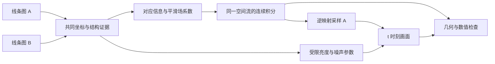

# twist：连续线条图变形设计

状态：规划，尚未实现。更新时间：2026-10-06。

## 1. 已确定的首版任务

输入两张线条图 A、B，寻找一条从 A 到接近 B 的合理连续轨迹，并能查询任意 `t ∈ [0,1]` 的画面。首版只求一条轨迹，不学习同一对端点之间的多种过渡。

这里的“任意”包含汉字、字母、图标、开放曲线、闭合曲线和多条线组成的图，不要求字符标签、书写者标签或固定笔画数量。能否处理某对输入，取决于它们是否具有兼容的主要结构、可辨认的对应关系，以及变形尺度是否落在模型和数值方法的能力范围内。

主要结构通过空间变形移动；有限的外观调整用于亮度和已确认的微小噪声。首版不预测新字符，不从风格参考推断未知终点，也不靠整幅图像生成来绕过几何约束。

| 维度 | 原 DiT-flow | twist 首版 |
|---|---|---|
| 输入 | 目标标准字与参考手写/标准字对 | 两张线条图 A、B |
| 目标 | 条件手写字生成 | 两个已知端点之间的连续过渡 |
| 演化的对象 | 像素强度状态 | 空间坐标映射，以及受限外观 |
| 时间含义 | 生成过程中的 flow 时间 | 同一几何轨迹的位置参数 |
| 主要结构约束 | 由训练目标和网络学习 | 通过可逆空间变形显式限制 |
| 新增或删除结构的能力 | 像素生成可以改变结构 | 主线条保留；仅允许受限噪声清理 |

两者都可以出现“速度”和“积分”，但速度的对象不同。旧模型的像素速度损失和图像线性插值训练路径不能直接作为新方案的几何监督。

## 2. “近似同构”与“合理”的操作定义

先把图分成主要线条结构和可选的噪声层。主要结构指在多个合理阈值、尺度下稳定存在的线段、端点、交点、连接关系与孔洞；短小或孤立本身不代表噪声，点状标记也可能是有效内容。

可接受的近似同构包括：主要结构一致，但位置、曲率、夹角、间距、局部粗细和墨色有所不同；少量不影响主要结构的碎点、扫描噪声允许单独清理。

不属于首版严格几何能力的情形包括：新增或删除主要笔画、连接与断开主要笔画、改变主要孔洞数量，以及需要遮挡、穿越或改变平面嵌入关系才能建立的对应。遇到这些情况，应报告结构不兼容或需要额外对应信息。

抽象图同构还不够。平面中连通分量的包围关系、交点周围线条的排列，以及被固定边界限制的运动，都可能影响是否存在从恒等映射连续出发的可逆变形。首版需要的是主要结构在平面中的连续可变形关系。

“合理”的首版标准是：

1. 对应的线条移动到目标位置，主结构全过程保持，不以淡出再出现代替移动。
2. 场足够平滑，无数值折叠、明显局部挤压、异常拉伸或越界裁切。
3. 时间连续，查询顺序和预览帧率不会改变轨迹。
4. 在可行的配准结果中优先选择较短、较平稳的运动，减少无意义绕行。
5. 终点误差与约束代价分别展示，不能用小的像素误差掩盖坏的几何结构。

这些标准是可检验的建模选择。只有 A、B 时，中间过程并不唯一；没有中间帧监督，就不能宣称恢复了真实运动过程，也不能保证得到人类唯一认可的过渡。

## 3. 表示与核心数学关系

### 3.1 图像和坐标

首版采用灰度栅格输入，保留二维位置。令图像亮度 `I ∈ [0,1]`，白色背景为 1，墨迹占有度为 `α = 1 − I`。A、B 采用共同画布与一致坐标单位；不要求固定为旧模型的 64×64。

预处理保留长宽比并记录坐标变换。默认使用共同画布归一化，避免各自紧裁切把本来要学习的平移、缩放和间距差消掉。需要初始对齐时，单独记录该变换，并把它纳入最终运动路径和导出映射。

同时计算软前景、距离场及结构置信度作为辅助通道。骨架和二值阈值用于监督、评估或候选对应，不作为不可更改的唯一真值。定义距离场时明确前景阈值、截断距离与正负号约定。

### 3.2 空间流

设 `p` 是 A 中的坐标，`φ_t(p)` 是它在时间 t 的位置：

\[
\frac{d\phi_t(p)}{dt}=v_\theta(\phi_t(p),t\mid A,B),
\qquad \phi_0(p)=p.
\]

`v` 输出二维空间速度，而不是像素亮度变化。为渲染输出坐标 y，需要使用逆向采样：

\[
\widetilde\alpha_t(y)=\alpha_A(\phi_t^{-1}(y)),
\qquad \widetilde I_t(y)=1-\widetilde\alpha_t(y).
\]

前向场用于跟踪线条和导出运动，逆向场用于图像采样。二者必须来自同一条流；时变场的逆映射要从相应时间反向积分，不能简单把位移取负。

墨色在这里是随图案输运的外观量，不按质量密度乘 Jacobian。几何拉伸可以改变线宽与总墨迹面积；是否限制这种变化由畸变约束决定。

### 3.3 可逆性的边界

在速度场具备足够空间正则性、时间连续性和适当边界条件，且解存在于整个时间区间的理想连续条件下，ODE 流给出从恒等映射出发的可逆变形。其局部体积变化满足：

\[
\det D\phi_t(p)=
\exp\!\left(\int_0^t\operatorname{div}v(\phi_s(p),s)\,ds\right)>0.
\]

这说明为什么选择积分平滑速度场，而不是独立预测每个 t 的任意位移。直接令 `φ_t(p)=p+t·u(p)` 即使终点看起来正确，中途也可能折叠。

以上条件不自动覆盖有限网格、浮点计算、插值与粗积分。正 Jacobian 的离散统计也不能独自证明全局没有重叠。因此仍需检查逆映射一致性、网格/线条碰撞、边界和积分收敛。

即使连续几何支持集保持拓扑，栅格重采样、亮度阈值和去噪仍可能改变二值图的连接关系。验收必须同时检查几何映射与实际渲染结果。

## 4. 首版的场参数化与模型候选

### 4.1 先验证静态速度场

第一阶段采用空间平滑的静态速度场 `v(p | A,B)`：

\[
\phi_t=\exp(t v),\qquad
\phi_t^{-1}=\exp(-t v).
\]

这里 `exp` 指速度场的流映射，不是对每个坐标逐元素取指数。它定义一条连续轨迹，容易检查反向映射，并适合先把配准、渲染和约束闭环跑通。

先直接优化一对图的低分辨率场系数，再考虑训练网络预测它们。这样可以分清失败来自表示、优化，还是学习模型。

静态速度场只是基线，不能声称覆盖所有可逆终点或所有合理路径。若基线出现终点拟合不足、难以处理的大幅转动，或明显不合理的运动顺序，再升级为时变速度场。

### 4.2 后续升级为时变场

候选表示为若干平滑时间基函数与空间场的组合：

\[
v(p,t)=\sum_{k=1}^{K}\beta_k(t)w_k(p\mid A,B).
\]

`β_k` 使用连续、必要时可微的时间样条；空间场以平滑 B 样条控制网格或等效平滑插值表示，显式限制幅度和导数。控制点网格初始为粗尺度，之后按需要细化。

时间连续性来自同一组场系数与积分，而不是逐帧重新预测。首版使用线性的物理时间参数；若仅为展示增加缓入缓出，要明确那是统一的时间重参数化，不改变端点和路径。

### 4.3 学习模型的推荐起点

候选为共享的多尺度 CNN 编码器、跨图的对应特征融合，以及预测粗场系数的解码器。局部相关性或跨图注意力帮助建立远距离对应；结构对称时，可接收少量人工端点/交点配对作为附加约束。

不默认沿用 DiT，也不先规定很大的 Transformer。首先用小型多尺度网络验证几何能力，再用端点质量、数值稳定性、延迟和分辨率扩展能力决定是否需要更复杂主干。

## 5. 保留小幅外观能力，但限制其职责

先完成纯几何基线，再加入外观分支。它预测受限的局部亮度参数和噪声衰减参数，不预测整幅新图像。外观参数同样沿源图坐标输运，避免不同帧独立去噪造成闪烁。

一种首版候选定义为：

\[
\alpha_t(\phi_t(p))=
\operatorname{clip}\!\left[
e^{t b(p)}\bigl(1-t\,m_{\rm noise}(p)d(p)\bigr)\alpha_A(p),
0,1\right].
\]

其中 `|b(p)| ≤ b_max` 控制墨色变化，`d(p) ∈ [0,1]` 控制去噪强度，`m_noise` 仅覆盖已确认可以删除的微小噪声。令 `I_t = 1 − α_t`，则数学上 `I_0=A`。噪声可以是很黑的小点，因此以面积、位置和结构身份限制去噪，而不只限制每像素的变化幅度。

这个参数化以乘性外观修正为起点，不在原本没有墨迹的区域凭空补主笔画。若以后需要轻微抗锯齿补偿，可单独引入幅度、面积和支撑区域都受限的残差；先做消融，证明它没有代替几何移动。

具体约束：

- 主线条的可信骨架区域禁止去噪，亮度变化后仍须通过多阈值结构检查。
- 噪声区域不能只靠终点损失自行学习；合成数据提供已知掩码，真实图使用保守候选、置信度或人工标记。不确定的小点按有效内容保留。
- 默认先调全局墨色，再加入缓慢变化的局部亮度，减少利用高频亮度变化隐藏结构的空间。
- 输出纯几何结果、外观修正结果和差值图，分别记录修正面积与幅度。
- 固定几何后再拟合外观，之后才考虑受限联合优化；同时保留关闭外观分支的对照。

若 B 的主要结构不能由 A 合法变形到达，外观分支不得通过删除或补画主笔画来降低误差。允许微小噪声消失，意味着保留的是主要结构的拓扑，不能宣称整幅原始栅格图的拓扑绝对不变。

## 6. 端点、对应关系与约束目标

### 6.1 端点策略

起点由恒等映射和零外观变化构造，因此应等于 A。终点通过配准与外观约束接近 B；任意两张栅格图不一定能在这些限制下逐像素精确相等。

当误差主要来自可容许的墨色或微小噪声时，由外观分支处理；当误差来自结构不兼容、模糊对应或表示不足时，输出原因与未匹配区域。不能在 `t=1` 强行切换为 B，也不能在最后几帧交叉淡化来伪装配准成功。

### 6.2 配准损失

首版组合前景加权的多尺度图像损失、距离场/轮廓距离，以及可用的端点、交点或曲线对应损失。像素误差必须控制白色背景的权重，否则几乎空白的输出也可能获得较低损失。

距离场宜按形状重新计算，或仅作为距离特征比较。非等距变形后的源距离场不再严格等于变形形状的真实距离场，不能把简单 warp 后的数值当成真实距离监督。

采用同一个流的正向和逆向配准，避免模型单向挤压前景来拟合。结构对称或多个相似分量时，单靠轮廓距离可能匹配错笔画；优先检查对应，并允许少量人工锚点。

### 6.3 正则项与硬检查

候选总目标为：

\[
\mathcal L=
\lambda_{\rm end}\mathcal L_{\rm end}
+\lambda_{\rm corr}\mathcal L_{\rm corr}
+\lambda_{\rm space}\mathcal L_{\rm space}
+\lambda_{\rm motion}\mathcal L_{\rm motion}
+\lambda_{\rm jac}\mathcal L_{\rm jac}
+\lambda_{\rm inv}\mathcal L_{\rm inv}
+\lambda_{\rm app}\mathcal L_{\rm app}.
\]

| 项目 | 目的 | 备注 |
|---|---|---|
| `L_end` | 双向终点图像与轮廓匹配 | 结构目标与外观目标分别记录 |
| `L_corr` | 保持正确的线条、端点与交点对应 | 有可信对应才启用 |
| `L_space` | 速度场的空间平滑与弯曲代价 | 平滑过强会丢失局部形变 |
| `L_motion` | 运动能量与路径平稳性 | 时变场再增加时间变化或粒子加速度代价 |
| `L_jac` | 限制压缩、拉伸、剪切与数值折叠 | 检查 Jacobian 奇异值；行列式单独不足以限制剪切 |
| `L_inv` | 映射与逆映射复合接近恒等 | 衡量离散积分和插值误差 |
| `L_app` | 限制墨色和去噪代价 | 防止外观分支承担结构变化 |

权重和畸变阈值通过合成几何误差与真实配准验证选取，当前不宣称已经确定。主要约束应是场参数化、外观支撑限制与输出检查；单纯增大拓扑损失权重并不能保证结构永远不变。

软拓扑损失或骨架连通性指标可作为补充，但要考虑阈值不稳定和栅格误差。验证同时检查连通分量、孔洞、端点/交点对应以及非相邻曲线间距，不能只检查欧拉示性数。

## 7. 连续时间与数值实现的后续要求

轨迹对象只建立一次，保存同一组场和外观参数。后续查询 t 不重新采样噪声，也不重新拟合端点。

- 静态基线可用 scaling-and-squaring 或 ODE 积分；需要验证它们在实际网格上的折叠和误差。
- 时变场采用明确的 ODE 求解器与误差容限，支持任意 t 的积分或可控误差的连续输出。
- 每帧从原始 A 重采样，避免把上一帧作为下一帧输入而不断累积模糊。
- 明确像素中心、坐标归一化、插值、抗锯齿和边界约定。扩展画布留白，防止有效线条被边界裁掉。
- 对连续场使用平滑的空间插值。若边界需要固定，可将速度在画布边缘平滑降为零，并检查主线条是否距边界足够远。
- 比较步长减半或容限收紧后的轨迹；在相同 t 对比稀疏查询、密集查询和乱序查询。
- 复合流满足带起止时刻的映射关系，但不能把非线性的两张中间图逐像素插值当作同一轨迹。

“任意 t”是同一连续模型的可查询能力，实际输出仍受数值容限和栅格精度限制。有限采样点都通过检查，不能据此严格证明两点之间永远无问题；必要时增加自适应检查，依据场的导数界和运动尺度细化。

## 8. 数据规划

### 8.1 先用可控合成数据

从非字符专用的线条结构开始：线段、圆弧、Bezier 曲线、开放/闭合轮廓、多个分量、交叉与分支图。覆盖不同线宽、密度、画布长宽比和局部间距。

先用已知静态平滑流构造 `B = warp(A)`，保留真值 `φ_t`、对应点与所有中间帧，验证静态基线。随后加入已知墨色变化、明确噪声掩码和可控扫描模糊，单独验证外观分支。

之后再生成时变场样本和更复杂路径，评估静态表示的不足，决定是否升级。训练生成器必须检查真实轨迹本身没有数值折叠，不把普通弹性位移直接当作可逆真值。

合成监督使用坐标/对应误差与渲染结果共同评估。它证明的是对这类运动的学习能力；在同一生成分布上表现好，不代表已支持任意真实线条图。

### 8.2 再加入真实图对

加入字母、图标、手绘线图和手写字等真实配对。CASIA 可以提供部分真实样本，但同一个字符也未必具有相同的连接关系；须检查结构兼容性，不默认全部为合法样本。

真实数据没有中间帧时主要使用端点配准和几何约束。少量曲线或锚点标注用来核对对应，特别是对称形状和重复线条。明确记录主要结构、噪声与不确定区域。

### 8.3 划分与反例

按源图/结构实例分组划分，避免同一源图的不同变形同时进入训练和验证。单独测试未见形状类型、连接结构、变形幅度、线宽和真实领域。

必须包含：A=B、整体移动/旋转、长细线、大幅局部弯曲、近接触线条、嵌套环、重复分量、有效小点，以及连接/断开/增删主线条等不兼容反例。反例用来检验模型是否报告失败，而不是靠外观分支强行通过。

新数据格式独立设计，保留图像、坐标元信息、配对、可选对应点、噪声掩码、合成场真值与来源。不要直接复用旧的书写者 episode 格式，也不要默认使用旧版独立紧裁切。

## 9. 验收与诊断输出

| 维度 | 验收内容 |
|---|---|
| 端点 | t=0 恒等；t=1 的前景、轮廓和可信对应误差 |
| 几何 | 最小 Jacobian、非正 Jacobian 比例、拉伸/剪切分布、线条碰撞与越界 |
| 可逆 | `φ_t⁻¹ ∘ φ_t` 的坐标误差，以及正逆渲染误差 |
| 连续性 | 不同 t 的线条运动连续；没有突然跳变、双影和亮度闪烁 |
| 时间查询 | 相同 t 在不同查询密度与顺序下得到一致结果 |
| 结构 | 多阈值/尺度的主要连接、孔洞、端点与交点关系 |
| 外观 | 亮度变化幅度、噪声删除面积、受保护主线条的完整性 |
| 数值收敛 | 更细步长/更高网格精度下结果和约束指标趋于稳定 |
| 泛化 | 未见结构和真实领域；不能只用汉字或同分布合成样本 |
| 代价 | 建立轨迹的时间、查询单个 t 的时间和内存 |

初始数值目标可以设为：起点误差仅来自约定的采样精度；验证中无检测到的折叠；加密积分后对应点变化与逆映射误差尽量控制在四分之一像素量级。这个数值是待校准的实验起点，需按分辨率、线宽和形变尺度调整，不能当作已经实现的性能。

每个验证样本保存 A、B、若干中间帧、纯几何终点、最终终点、外观差值图、运动网格和约束报告。中间帧可先取 `0, 0.1, 0.25, 0.5, 0.75, 0.9, 1`，接近碰撞或畸变大的区间额外采样。

对 B→A 单独拟合的轨迹，不默认它与 A→B 完全相反；不同优化可选择不同对应或路径。首版的反向一致性重点检查同一条已拟合流的逆映射。

## 10. 分阶段推进与升级条件

| 阶段 | 后续工作 | 通过后再继续 |
|---|---|---|
| 0：本次 | 整理原实现、固定任务边界、保存设计 | 只有文件整理和文档，无新模型代码 |
| 1：几何闭环 | 对少量合成 A/B 直接优化静态平滑场，渲染任意 t | 端点合理、无检测到的折叠、逆映射与积分收敛通过 |
| 2：学习配准 | 小型多尺度网络预测场；与逐对优化比较 | 未见源图也能配准，对应可解释，白底不主导损失 |
| 3：外观修正 | 先亮度、后已知微小噪声，固定几何后验证 | 主结构完整，纯几何与修正差异可审查 |
| 4：真实与复杂输入 | 多领域配对、锚点、反例；按证据加入时变场 | 真实域有效，失败可识别，任意 t 查询稳定 |

如果阶段 1 就无法得到合理路径，应先检查结构兼容性、对应与场表示；不能靠扩大神经网络或放开图像残差掩盖几何问题。若静态场始终需要异常扭曲才能拟合，而时变场能明显改善，再把时变场作为主路线。

多轨迹分布、风格参考条件、显式矢量曲线和更大的生成能力都留作后续方向，不纳入首版验收。当前也不计划为 twist 引入额外依赖或固定模型规模。

## 11. 文件边界与可复用内容

本次 `twist/` 只创建 `README.md` 与本设计。后续真正实现时，可按场表示/积分、配准模型、受限外观、数据、约束与评估拆分，但现在不创建空的 Python 模块。

根目录保留字体、公共依赖、论文资料与参考项目。后续数据建议使用 `data/twist/`，结果使用 `runs/twist/`；旧数据仍可以通过明确路径引用，不要求重做。

原 `DiT-flow/` 的参考编码器、条件 DiT、像素 flow matching、字符 episode 数据与训练配置保持独立。梯度诊断、存储健壮性等工程工具在实际有第二个调用方时再提取公共模块；几何预处理、坐标约定和新评估不能直接沿用旧模型的隐含假设。
